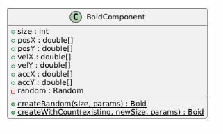
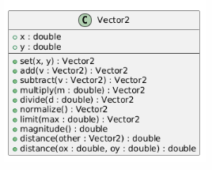
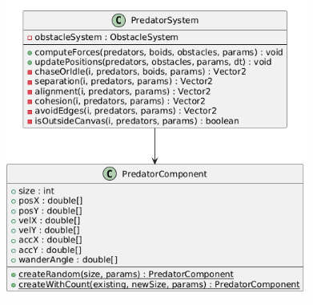
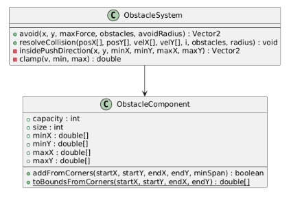
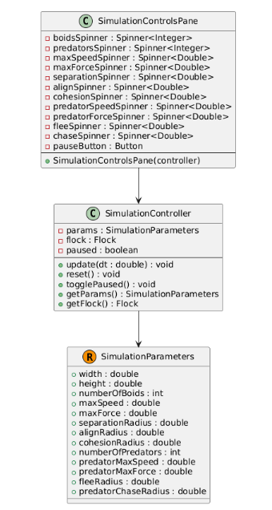
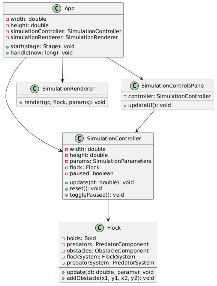

# Boids Simulation

A boids flocking simulation built with Entity Component System (ECS) architecture in Java with JavaFX visualisation.

---

## Start guide

### Prerequisites

- Java 25 or higher
- Maven 3.8+
- JavaFX 25.0.2

### Building the Project

```bash
cd boids-simulation
mvn clean package
```

### Running the Simulation

```bash
mvn javafx:run
```

### Running Tests

```bash
mvn test
```

---

## Usage & Controls

### Interactive Controls

| Action               | Effect                                         |
| -------------------- | ---------------------------------------------- |
| Control panel        | Adjust all simulation parameters in real-time  |
| Mouse click and drag | draws square obstacles                         |
| Reset Button         | Return to default parameters and initial state |

### Parameter Tuning

#### Boid Behavior:

- `numberOfBoids`: Population size
- `maxSpeed`: Maximum velocity magnitude
- `maxForce`: Maximum steering force
- `separationRadius`: Distance for separation behavior
- `alignRadius`: Distance for alignment detection
- `cohesionRadius`: Distance for cohesion detection

#### Predator Behavior:

- `numberOfPredators`: Count of hunting predators
- `predatorMaxSpeed`: Predator velocity limit
- `predatorMaxForce`: Predator steering limit
- `fleeRadius`: Distance at which boids detect predators
- `predatorChaseRadius`: Distance at which predators detect boids

---

## Features

### Baseline Behavior

Original boids behaviors :

- Separation, Alignment, Cohesion, Edge Avoidance
- Configurable detection radii for each behavior

### ECS Optimisation

- Boid force accumulation runs with `IntStream.range(...).parallel()`, distributing independent entity work across CPU cores.
- Contiguous primitive arrays (`posX`, `posY`, `velX`, `velY`, `accX`, `accY`).
- Force computation and integration are split.
- Elapsed time `dt` from the animation timer is used, so motion scales with real time rather than frame count.



### Vector2 Optimisations

- `set/add/subtract/multiply/divide/normalize/limit` mutate and return the same instance.
- helper vectors (for example `diff` and `neighbourVel`) are reused with `set(...)` inside neighbour loops to reduce per-frame allocation.
- `limit(max)` computes squared magnitude first and only executes `sqrt` when magnitude exceeds threshold, reducing expensive math calls.
- Distance methods accept raw coordinates, allowing many checks without constructing temporary vector objects.



### Predator System

Copy of boids but with new visual and behaviours:

- Each predator performs a nearest-neighbour scan across boids each frame. If nearest distance <= `predatorChaseRadius`, it applies a pursuit steering vector toward that boid. Alternatively, it switches to flock like idle behaviour.

- Boids compute a flee contribution for each predator inside `fleeRadius`, using normalised direction away from predator and inverse-distance weighting before averaging.



### Obstacle System

- Clicking and draging the mouse captures two corners and draws in an obstacle.
- Each obstacle applies a repulsive steering force for boids when inside an avoidance radius.
- When a boid is inside an obstacle, an outward push direction ejects it.



### Simulation control panel

- UI updates are pushed into `SimulationParameters`, and the controller uses updated values in the next simulation tick.
- boid/predator counts can be changed live by rebuilding component arrays and copying overlapping states to preserve their original positions and paramaters.
- pause stops updates, while reset restores defaults and recreates simulation state.



## Design Architecture

- **Components** hold data (positions, velocities, accelerations)
- **Systems** contain behavior logic operating on components
- **Controllers** manage entity lifecycle and state transitions

### Runtime Execution Pipeline

Per frame, execution follows this order:

1. `AnimationTimer` computes `dt` in seconds.
2. `SimulationController.update(dt)` dispatches to `Flock.update(dt, params)` when not paused.
3. Systems compute steering/forces (parallel phase) and write acceleration arrays.
4. Systems integrate velocity and position using `dt`, then apply obstacle collision resolution.
5. Renderer draws boids, predators, obstacles, and stats.

### System Architecture Diagram


